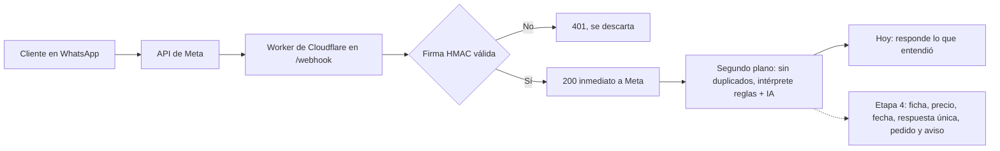

# Brunen Chatbot

Bot de WhatsApp que recibe pedidos de bidones de agua de Brunen SpA, calcula el precio y la fecha de entrega, y deriva a una persona lo que no debe manejar. Cloudflare Workers + TypeScript, con costo objetivo de USD 0 al mes.

*English: a WhatsApp ordering assistant for a small Chilean water-delivery business, built on Cloudflare Workers and TypeScript. Deployed in test mode; no paid infrastructure.*

## El problema
Brunen vende por WhatsApp el 100 % de sus pedidos: una persona recibe cada mensaje, lo agenda, lo anota a mano y arma la ruta del día, con 15 a 20 clientes diarios. El bot busca quitarle esa carga repetitiva sin quitarle el control: el bot registra y propone, y una persona confirma.

## Estado
| Etapa | Qué incluye | Estado |
|---|---|---|
| 0 | Precios, despacho, firma del webhook y pruebas | Lista |
| 1 | Worker desplegado y conectado a la API de WhatsApp de Meta (modo prueba) | Lista |
| 2 | Deduplicación por mensaje en la base D1, registro en Google Sheets y feriados | Lista |
| 3 | Intérprete de mensajes: reglas y respaldo con IA (Groq) | Lista |
| 4 | Flujo de pedido: cliente, precio, fecha, memoria de la conversación, registro | Piezas listas y probadas, sin conectar: esperan decisiones del dueño |
| 5 | Bandeja de pedidos y avisos para la operadora; Telegram solo para lo muy urgente | Aviso de Telegram listo; la bandeja pasa al panel |
| 6 | Comprobantes, audio y lista del día para el repartidor | Lista del día lista; falta decidir dónde guardar los comprobantes |
| 7 | Producción y piloto con clientes | Pendiente |
| P | Panel de administración: pedidos, avisos, clientes por ubicación, mapa y estadísticas | Dirección decidida; empieza al conectar el flujo |

Hoy el bot responde a los números de prueba lo que entendió del mensaje ("Modo prueba. Entendí: pedido · 2 de 20 L · entrega propuesta jueves 29 de octubre"). Lo que ya está construido para el flujo real, y cómo conversará con los clientes, está en [docs/CONVERSACIONES.md](docs/CONVERSACIONES.md). Detalle y criterios de cada etapa en [docs/ETAPAS.md](docs/ETAPAS.md).

## Cómo funciona

## Decisiones que vale la pena mirar
- **Webhook seguro:** valida `X-Hub-Signature-256` (HMAC-SHA256 con comparación en tiempo constante), responde 200 de inmediato y procesa con `ctx.waitUntil`, porque Meta reintenta si tarda.
- **El LLM extrae, el código calcula:** precios, tramos, corte horario y feriados son funciones deterministas con pruebas, en zona horaria `America/Santiago`. La IA solo entra cuando las reglas no entienden, con un tope diario, validando todo lo que devuelve y sin recibir nombres ni teléfonos.
- **Lo dudoso no se le promete al cliente:** si el precio depende de algo pendiente, la tabla de precios tiene errores o la fecha no es segura, el pedido se anota igual, una persona recibe los motivos y al cliente se le dice que se lo confirman.
- **Presupuesto de mensajes:** WhatsApp regala 1.000 mensajes de servicio al mes por número. El diseño apunta a 1 mensaje por pedido, junta los mensajes seguidos del cliente y no responde a un simple "gracias".
- **Plan gratuito de Cloudflare:** 10 ms de CPU por solicitud. Las lecturas de la planilla se guardan en memoria, el token de Google se pide una sola vez y el flujo lee solo lo que cada mensaje necesita.
- **Datos personales:** los teléfonos se enmascaran en los logs, los secretos viven solo en `.dev.vars` o en `wrangler secret`, la IA corre con retención de datos cero y los datos reales de clientes no entran al repositorio.
- Las 32 decisiones, con su motivo y su fuente, están en [docs/DECISIONES.md](docs/DECISIONES.md).

## Calidad
- Más de 600 pruebas automáticas con Vitest: los casos de precios del negocio, mensajes de ejemplo para el intérprete y conversaciones completas de punta a punta.
- Las pruebas de la base de datos corren el SQL de verdad sobre SQLite con las migraciones reales, no sobre un doble.
- TypeScript en modo estricto y CI en GitHub Actions (`npm run check` en cada push).
- Scripts para validar la configuración y simular un mensaje firmado como Meta, sin depender de Meta.

## Estructura
| Carpeta | Contenido |
|---|---|
| `src/` | Worker, firma, WhatsApp, deduplicación, intérprete y respaldo con IA, precios, fechas y despacho, lectura de la planilla, motor del flujo de pedido y avisos |
| `tests/` | Pruebas, mensajes de ejemplo (`mensajes.json`) y ayudas compartidas |
| `migrations/` | Esquema de la base D1 |
| `scripts/` | `verificar-config`, `simular-mensaje` y `preparar-planilla` |
| `docs/` | Conocimiento del negocio, decisiones, etapas, pendientes, conversaciones de ejemplo y guía de desarrollo |

Para correrlo, probarlo y desplegarlo: [docs/DESARROLLO.md](docs/DESARROLLO.md).

## Autor
Franco Rodríguez Torres, para Brunen SpA.
