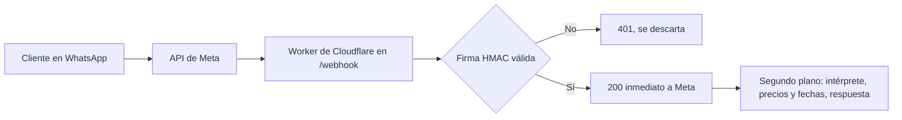

# Brunen Chatbot

Bot de WhatsApp que recibe pedidos de bidones de agua de Brunen SpA, calcula el precio y la fecha de entrega, y deriva a una persona lo que no debe manejar. Cloudflare Workers + TypeScript, con costo objetivo de USD 0 al mes.

*English: a WhatsApp ordering assistant for a small Chilean water-delivery business, built on Cloudflare Workers and TypeScript. Deployed in test mode; no paid infrastructure.*

## El problema
Brunen vende por WhatsApp el 100 % de sus pedidos: una persona recibe cada mensaje, lo agenda, lo anota a mano y arma la ruta del día, con 15 a 20 clientes diarios. El bot busca quitarle esa carga repetitiva sin quitarle el control: el bot registra y propone, y una persona confirma.

## Estado
| Etapa | Qué incluye | Estado |
|---|---|---|
| 0 | Precios, despacho, firma del webhook y pruebas | Lista |
| 1 | Worker desplegado y conectado a la API de WhatsApp de Meta (modo prueba) | Lista |
| 2 | Deduplicación por mensaje en la base D1 y registro de mensajes y errores en Google Sheets | Lista, falta cargar los feriados |
| 3 | Intérprete de mensajes por reglas | Parcial: funciona y está probado, aún sin conectar al bot |
| 4 a 7 | Flujo de pedido, alertas a la operadora, comprobantes, producción y piloto | Pendientes |

Hoy el bot responde "Recibí: …" a los números de prueba. Detalle y criterios de cada etapa en [docs/ETAPAS.md](docs/ETAPAS.md).

## Cómo funciona

## Decisiones que vale la pena mirar
- **Webhook seguro:** valida `X-Hub-Signature-256` (HMAC-SHA256 con comparación en tiempo constante), responde 200 de inmediato y procesa con `ctx.waitUntil`, porque Meta reintenta si tarda.
- **El LLM extrae, el código calcula:** precios, tramos, corte horario y feriados son funciones deterministas con pruebas, en zona horaria `America/Santiago`.
- **Reglas primero, LLM de respaldo:** la mayoría de los pedidos son repetitivos, y las reglas son gratis y se pueden probar. El LLM solo recibiría el texto del mensaje, nunca nombres ni direcciones.
- **Presupuesto de mensajes:** WhatsApp regala 1.000 mensajes de servicio al mes por número. El diseño apunta a 1 mensaje por pedido y no responde a un simple "gracias".
- **Datos personales:** los teléfonos se enmascaran en los logs, los secretos viven solo en `.dev.vars` o en `wrangler secret`, y los datos reales de clientes no entran al repositorio.
- Las 21 decisiones, con su motivo y su fuente, están en [docs/DECISIONES.md](docs/DECISIONES.md).

## Calidad
- Más de 250 pruebas automáticas con Vitest, entre ellas los casos de precios del negocio y mensajes de ejemplo para el intérprete.
- TypeScript en modo estricto y CI en GitHub Actions (`npm run check` en cada push).
- Scripts para validar la configuración y simular un mensaje firmado como Meta, sin depender de Meta.

## Estructura
| Carpeta | Contenido |
|---|---|
| `src/` | Worker, firma, WhatsApp, deduplicación, precios, despacho, comunas e intérprete |
| `tests/` | Pruebas y mensajes de ejemplo (`mensajes.json`) |
| `migrations/` | Esquema de la base D1 |
| `scripts/` | `verificar-config` y `simular-mensaje` |
| `docs/` | Conocimiento del negocio, decisiones, etapas, pendientes y guía de desarrollo |

Para correrlo, probarlo y desplegarlo: [docs/DESARROLLO.md](docs/DESARROLLO.md).

## Autor
Franco Rodríguez Torres, para Brunen SpA.
