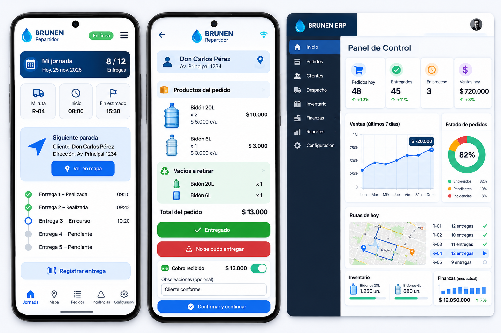
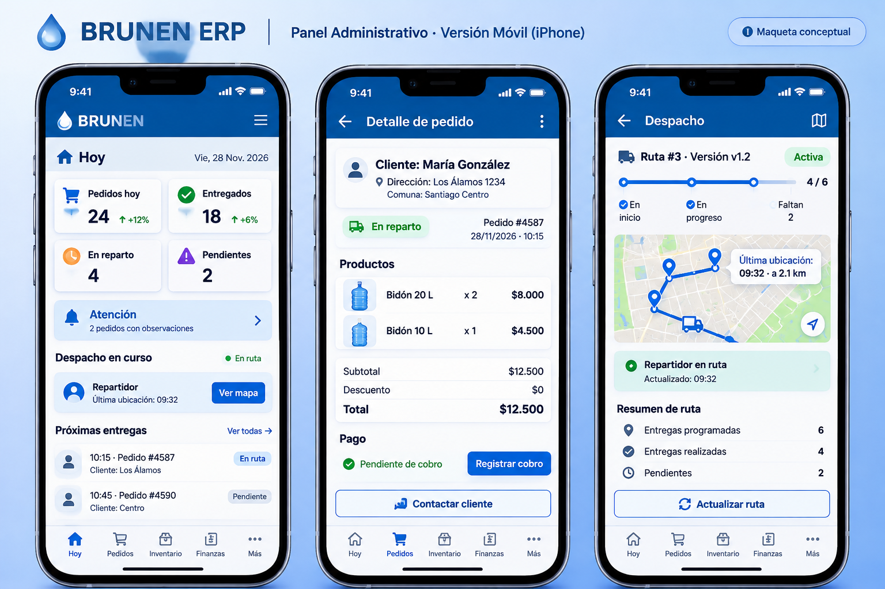

# Experiencias móviles: app del repartidor (Android) y panel en iPhone

> Fuente: la especificación "Integración de experiencias móviles — BRUNEN ERP" y las maquetas V07 y V08 que Franco compartió el 2026-11-26 (D89). **Es una lista de mejoras posibles, no un plan aprobado:** cada una se construye cuando Franco la elija. Las maquetas son conceptuales.

La especificación coincide con lo que ya decidimos: un solo backend (los Workers y D1 de siempre), dos experiencias (el repartidor en Android y la administración en el teléfono), permisos en el servidor, nada de frameworks nuevos y costo cero. Lo que aporta es una lista ordenada de lo que falta.

---

## Las maquetas

| V07: app del repartidor (Android) y panel de escritorio | V08: panel administrativo en iPhone |
|---|---|
|  |  |

**Lo que sirve de ellas:**
- La siguiente parada arriba, destacada, con su botón de mapa.
- El avance a la vista ("8 / 12 entregas").
- Entregado y No se pudo como dos botones grandes.
- La última ubicación con su hora ("Última ubicación: 09:32").
- Tarjetas en vez de tablas, y una barra de navegación abajo en el teléfono.

**Lo que no hay que copiar:**
- **Datos inventados.** El "Bidón 6L" no existe en el catálogo de Brunen (20, 12 y 10 L). Los precios ($5.000 c/u, $720.000 de ventas), los nombres, las rutas "R-04" y "Ruta #3 v1.2" y los porcentajes son ilustrativos.
- **Funciones que no existen hoy:** escanear un código, Inventario, Finanzas, versiones de ruta, "Registrar cobro" con estados y medios de pago. Algunas son parte de la visión ([MEJORAS.md](MEJORAS.md) §7), pero no deben aparecer en la app antes de existir.

---

## App del repartidor: qué hay y qué falta

| Pide la especificación | Hoy | Falta | Tamaño | ¿Decide alguien? |
|---|---|---|---|---|
| **Mi jornada:** fecha, conexión, estado de la jornada, inicio, entregas hechas y pendientes | Fecha, paradas, bidones, viajes y cuántas están listas; "Ruta iniciada a las 08:00"; aviso sin conexión | El avance como "8 de 12" bien visible | Chico | No |
| **Siguiente parada destacada** | Todas las tarjetas se ven iguales, en el orden de la ruta | Una tarjeta "Siguiente" arriba, con Navegar | Chico | No |
| **Estados** pendiente, en curso, entregada, no se pudo | Pendiente, Entregado, No se pudo, "(por enviar)" y "No se anotó" (D84) | "En curso" (opcional) | Chico | No |
| **Cliente:** nombre, dirección del pedido, comuna, teléfono, observaciones | Sí | — | — | — |
| **Pedido:** productos, precio unitario, total, descuentos, estado de pago, saldo | Productos y cantidades; el monto a cobrar si paga en efectivo | Precio y total de todos los pedidos | Chico | **Sí:** hoy el repartidor ve solo lo que cobra (dato mínimo) |
| **Envases:** llenos a entregar y vacíos a retirar, por formato | "Deja: 3 de 20 L" y "Retirar: N vacíos (M que debía)" | Vacíos por formato | Medio | Va con el libro de envases |
| **Navegación y ubicación** con su antigüedad | Navegar, Waze, la ruta del viaje en Maps y "compartiendo (última hace 20 s)" | Un mapa dentro de la app | Medio | No |
| **Entregado:** lo entregado, vacíos, cobro, observaciones, hora del servidor y repartidor | Vacíos, cobró sí o no (el total), la hora (del servidor, o la del teléfono si llegó tarde, D84) y quién | Observaciones al entregar | Chico | No |
| **No se pudo:** motivo de una lista, observaciones, queda pendiente | Sí: 5 motivos con detalle y un aviso para reagendar | — | — | — |
| **Cobros:** monto recibido, medio, pago parcial, informado / registrado / conciliado, sin duplicados | Cobró sí o no, por el total; el pedido queda pagado o pendiente | Todo lo de la propuesta de cobros | Grande | **Sí** ([PROPUESTA_SIGUIENTES_PASOS.md](PROPUESTA_SIGUIENTES_PASOS.md)) |
| **Inventario del reparto:** carga, entregados, vacíos, devueltos, diferencias, cierre | Cierre del día con efectivo y vacíos (D64) y carga por viaje (D67) | Libro de movimientos | Grande | **Sí:** regla del saldo de envases |
| **Incidencias:** cliente ausente, dirección, rechazo, acceso, diferencias, pago, vehículo | Los 5 motivos de "No se pudo" | Incidencias sin parada (el vehículo) y diferencias | Medio | **Sí:** la lista de categorías (Felipe y Constanza) |
| **Sincronización:** en línea, sin conexión, sincronizando, cambios pendientes, última sincronización, error | Aviso sin conexión, "(por enviar)" y rechazos a la vista (D84) | Una línea fija con el estado y la última sincronización | Chico | No |
| **Operaciones sin señal**, solo con todo diseñado y probado | Hecho en D84: identificador por marca, reintentos, rechazos visibles, confirmación del servidor, sobrevive a cerrar la app y pregunta antes de salir | Que lo guardado en el teléfono venza por tiempo; qué pasa si la ruta se republica mientras hay marcas pendientes | Chico | No |
| **Navegación** Jornada, Mapa, Pedidos, Incidencias, Configuración | Una sola pantalla con todo | Pestañas abajo, cuando haya más de una pantalla | Medio | No |
| **Seguridad:** solo su jornada, revocar el acceso, permisos en el servidor | Sesión, permisos en el servidor; al desactivarlo se cierra su sesión y se borra su seguimiento (D84) | **Todos los repartidores ven la misma ruta del día**: no hay asignación por repartidor | Medio | Solo si trabajan dos repartidores a la vez |

## Panel en iPhone: qué hay y qué falta

| Pide la especificación | Hoy | Falta | Tamaño | ¿Decide alguien? |
|---|---|---|---|---|
| **Hoy:** pedidos, por confirmar, en reparto, entregas, incidencias, repartidor y ubicación, próximas entregas | "Hoy" con tarjetas que abren su lista (D70), la hora de los datos (D88), y el repartidor con su última ubicación y las próximas entregas (D92) | Las alertas "sin señal" y "ruta no iniciada" | Chico | **Sí** (umbrales) |
| **Pedidos y clientes:** buscar, historial, pago, sin cambiar el pasado | Sí (D53, D57); cada pedido guarda su dirección y su precio | — | — | — |
| **Despacho:** viajes, ubicación con antigüedad, versiones de la ruta y acuse del repartidor | Ruta del día, viajes guardados (D86), ubicación con antigüedad | Versiones de la ruta publicada y que el repartidor confirme los cambios | Medio | No |
| **Inventario y Finanzas** | No existen | La visión, por etapas | Grande | **Sí** |
| **Alertas:** repartidor sin señal, ruta no iniciada, cobros por conciliar, errores | Avisos, el vigía y Telegram | "Repartidor sin señal hace más de N min" y "ruta no iniciada a las HH:MM" | Chico a medio | **Sí:** los umbrales |
| **Navegación abajo:** Hoy, Pedidos, Inventario, Finanzas, Más | Pestañas arriba (Hoy, Pedidos, Clientes, Reparto, Avisos) | Barra abajo en el teléfono, solo con las secciones que existen | Medio | No |
| **iPhone:** controles táctiles, tarjetas, áreas seguras | Botones de 44 px en pantallas táctiles, tarjetas, probado a 375 px | Revisar el borde de la pantalla (notch) y las tablas que quedan | Chico | No |

**Integración técnica, auditoría y costo:**
- Ya se cumple: un backend, las mismas APIs y la misma base para las dos experiencias.
- El historial de cada pedido dice quién hizo qué y cuándo. Falta anotar la sesión o el dispositivo y un identificador de operación.
- Nada de lo propuesto agrega costo mensual.

---

## Orden recomendado

1. **Chicos, sin decisiones** (app del repartidor): ~~siguiente parada destacada, el avance "8 de 12" y una línea fija de sincronización~~ (hechos, D90); ~~observaciones al entregar~~ (hecho, D91).
2. **Panel en el teléfono:** ~~el repartidor y su última ubicación en Hoy~~ (hecho, D92), y las alertas "sin señal" y "ruta no iniciada" (con umbrales que decidas).
3. **Versiones de la ruta**, con el acuse del repartidor.
4. **Cobros** (propuesta 2): ahí entran el monto, el medio de pago, el pago parcial y "por verificar".
5. **Libro de envases:** vacíos por formato y cierre con diferencias.
6. **Navegación abajo** en el teléfono (app y panel), cuando haya más secciones.
7. **Inventario y finanzas.**

## Dónde la especificación choca con lo que ya se decidió
- **Entrega parcial:** la especificación la deja fuera hasta aprobarla, igual que hoy.
- **Precios para el repartidor:** hoy ve solo lo que debe cobrar en efectivo. Mostrarle el precio de todo es decisión del negocio.
- **Un repartidor por ruta:** la especificación pide que cada uno vea solo lo suyo. Hoy hay un repartidor y una ruta. Se construye cuando trabajen dos a la vez.
